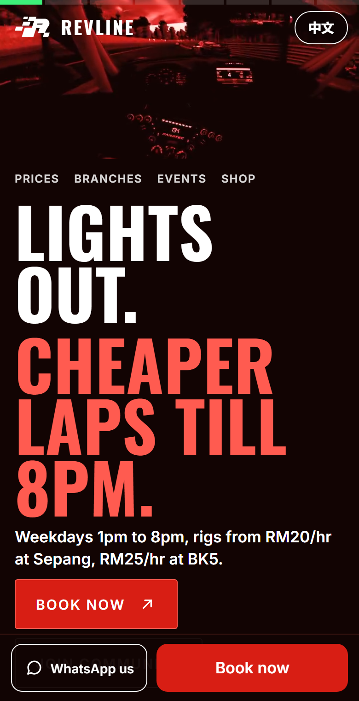
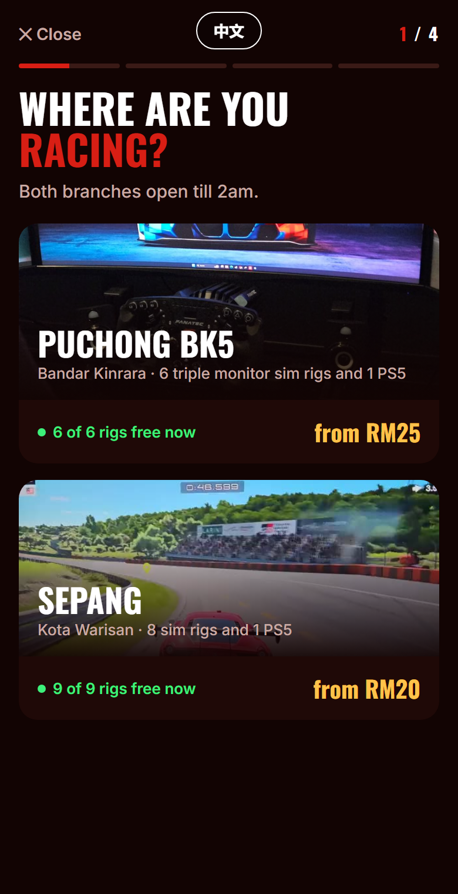
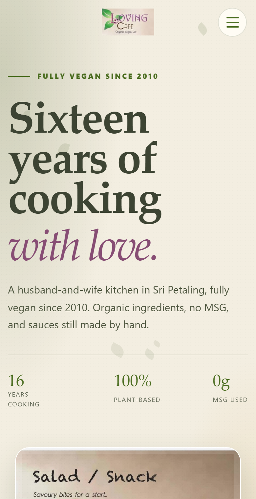

# Hi, I'm Hao Xiang

16, Kuala Lumpur. I design, build and maintain websites and online booking systems for real local businesses. Paid clients, live today.

## RevLine Sim Racing: website + online booking

Two-branch sim racing centre (Puchong and Sepang). Customers used to book over WhatsApp. Now they pick a branch, rig and time, and pay by DuitNow QR themselves. Staff see every booking on a live timeline.

- 3-minute payment hold + a live "someone paying" countdown, so no rig is double-booked
- Staff timeline, walk-ins, rig out-of-action, English / BM / Chinese
- Cloudflare Pages + D1 database, 320+ automated tests on every deploy

**Live:** [www.revline.my](https://www.revline.my) · [book.revline.my](https://book.revline.my)

  
  

## Loving Café: website

Menu, photos and location for a local café.

**Live:** [lovingcafe.pages.dev](https://lovingcafe.pages.dev)

---

Client code is private. Happy to walk through it on a call.
